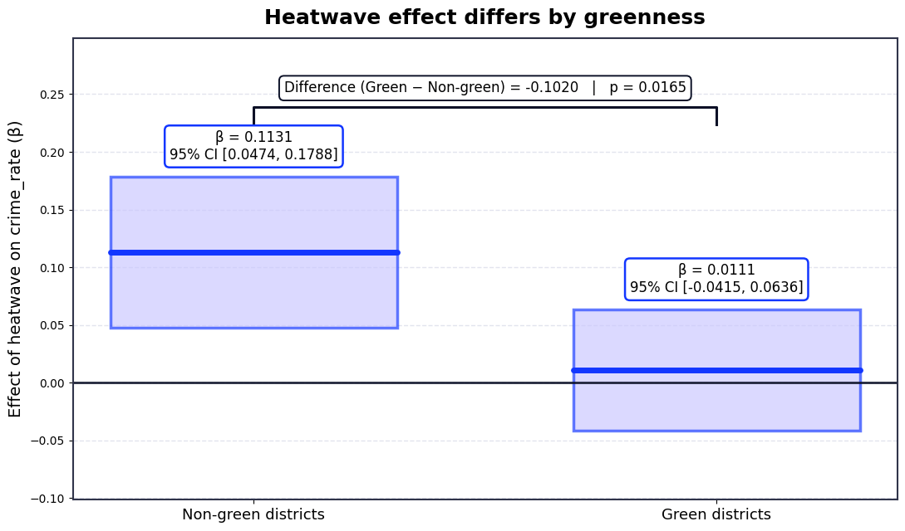
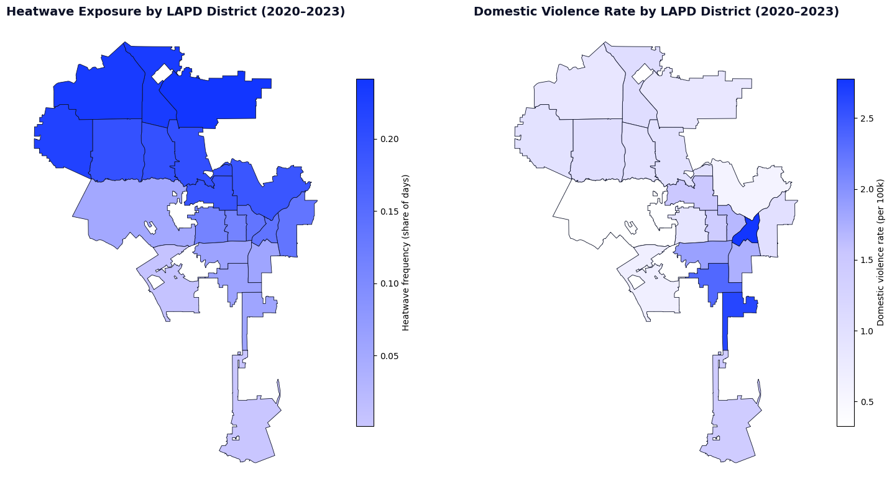

# Burning From Within: Heat Waves and Domestic Violence in Los Angeles

*MGMT 499 group project: causal inference with panel data*

Do heat waves increase domestic violence? And does urban greenery buffer the effect? We build a **district × day panel** for the 21 LAPD divisions (2020–2023) by combining LAPD domestic-violence calls with daily weather and satellite-measured vegetation. We then estimate the effect of heat waves with **two-way fixed-effects panel regressions**.

📓 **Full analysis:** [`Heatwaves_Domestic_Violence_LA.ipynb`](Heatwaves_Domestic_Violence_LA.ipynb) (runs in Google Colab and loads its data straight from this repo)

## Key findings

| Model | Heat-wave effect on DV rate |
|---|---|
| Pooled OLS (no controls) | not significant (p = 0.26), because districts that are hotter differ in other ways |
| District + day-of-week/month/year fixed effects, weather controls | **+4.4 %** (p = 0.037) |
| … in concrete-heavy (non-green) districts | **+11.3 %** (p < 0.001) |
| … in green districts | +1.1 % (not significant); the difference between the two is significant (p = 0.017) |

- **Heat drives violence, but only within-district comparisons show it.** In simple cross-sectional maps, hotter districts even look *less* violent.
- **The burden is unequal.** The effect is about 10× stronger where tree cover is low.
- **Timing matters more.** Sundays (+37 %), Saturdays (+22 %) and holidays (+28 %) dwarf the heat effect, and the two add up rather than amplify each other.

The notebook also covers endogeneity (measurement error, omitted variables), heterogeneity and limitations.




## Data

| File | Description |
|---|---|
| `data/final_panel.csv` | Final district-day panel used in all models: crime counts and rates, population, temperature, precipitation, humidity, heat-wave indicators (≥30/35/38 °C for 3–5 days), holidays, greenness index and green dummy |
| `data/LAPD_Divisions.geojson` | LAPD division boundaries (for the maps) |
| `data/raw/Dom_viol_LA.csv` | Raw LAPD domestic-violence incidents (City of Los Angeles open data) |
| `data/raw/temp_LA.csv` | Raw daily temperature series for Los Angeles |

## Repository structure

```
├── Heatwaves_Domestic_Violence_LA.ipynb   # final analysis (narrative + models + figures)
├── tiger_helpers.py                       # the same models packaged as reusable functions
├── data/                                  # panel, boundaries and raw inputs
└── assets/                                # figures exported from the notebook
```

## How to run

Open the notebook in Google Colab, or run it locally:

```bash
pip install -r requirements.txt
jupyter notebook Heatwaves_Domestic_Violence_LA.ipynb
```
